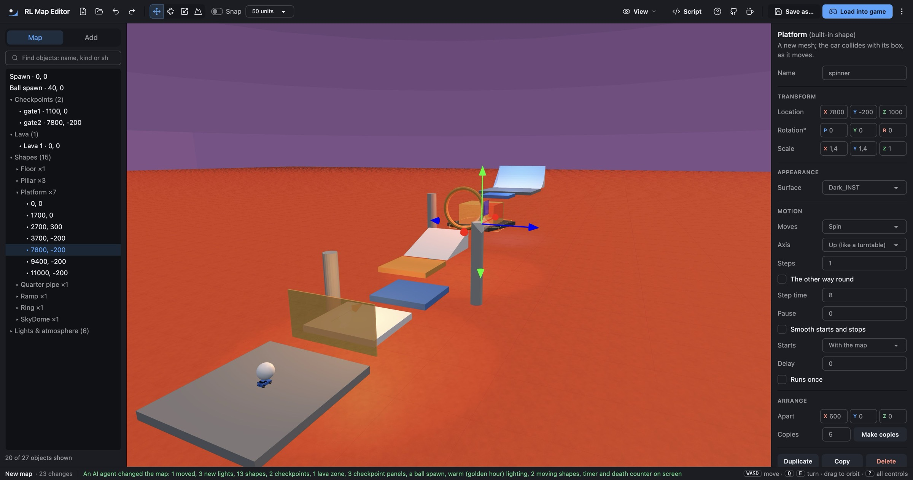

# RL Map Editor

A map editor for Rocket League workshop maps that runs in the browser. Open a map, build on it, and save it as a
`.udk` again, or start a new one from scratch. No UDK, no install, and your maps never leave your computer.

**Open it: [rl-map-editor.hajnalben.com](https://rl-map-editor.hajnalben.com)**



## What it does

- **Opens workshop maps** (`.udk`, UDK 2015 / package version 868), compressed ones too, and saves them back.
  **New map** writes a complete map from scratch.
- **Shapes:** platforms, ramps, pillars, rings and quarter pipes; shapes taken from other maps along with their looks;
  your own 3D models (`.glb`, `.gltf`, `.obj`, `.stl`); pictures as textures.
- **Courses:** checkpoints with resets, lava, an on-screen timer and death counter, trigger and gravity zones.
- **Moving shapes:** slide, follow a path, spin or swing, previewed in the view as the game plays them.
- **Lights and moods:** point, spot, sun and sky lights, and lighting presets.
- **Terrain:** sculpt hills, mountains and roads.
- **Scripts:** events and reactions written in JavaScript, turned into the Kismet the game runs.
- **Load into game:** swaps your map in for Free Play's Underpass, keeping a backup of the original (Chrome or Edge).
- **AI agents** can build maps through `window.mapAI`; see [ai-guide.md](ai-guide.md).
- **Works offline** once loaded, and installs as an app.

## Running it locally

There is no build step: the page is plain ES modules, and its libraries load from a CDN. Serve the folder with any
static server and open it:

```bash
python3 -m http.server 8000
```

Node is only needed for the checks: `npm install`, then `npm run check` (map format round trips against the
fixtures) and `npm run types` (TypeScript over the JSDoc).

## Where things are

| File | What it holds |
|---|---|
| [ue3.js](ue3.js) | Reading and patching UE3 packages, including compressed ones (zlib and LZO) |
| [blank.js](blank.js) | A whole map written from code, for new maps |
| [mesh.js](mesh.js), [physx.js](physx.js) | Static mesh data and its collision; cooked PhysX convex hulls for moving shapes |
| [texture.js](texture.js), [looks.js](looks.js) | Writing textures into a map; reading how its surfaces look |
| [kismet.js](kismet.js), [rules.js](rules.js), [script.js](script.js) | Checkpoints, map scripts and the Kismet they become |
| [doc.js](doc.js), [map.js](map.js) | The map as plain data, and applying edits to the file |
| [main.js](main.js), [view.js](view.js), [ui.js](ui.js) | The editor itself: actions, the three.js view, the panels |

## Thanks

Built on [three.js](https://threejs.org), [Preact](https://preactjs.com) with [htm](https://github.com/developit/htm)
and signals, [Tailwind CSS](https://tailwindcss.com), [daisyUI](https://daisyui.com) and
[Lucide](https://lucide.dev) icons. Reading the game's own packages follows
[RLUPKTool](https://github.com/Martinii89/RLUPKT).

If it saved you some time, you can [buy me a coffee](https://buymeacoffee.com/hajnalben).

## License

[MIT](LICENSE)
